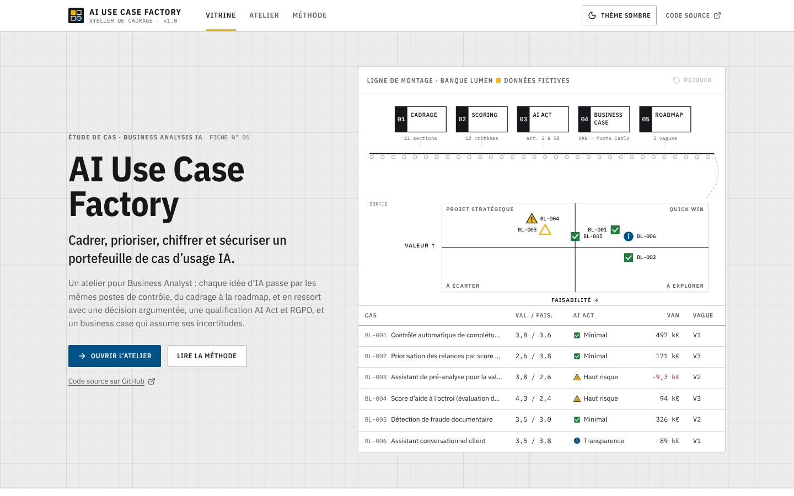
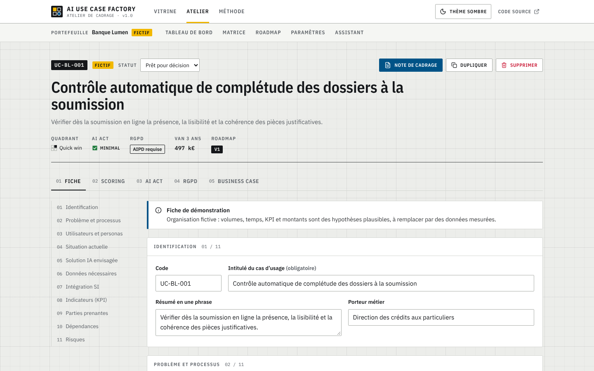
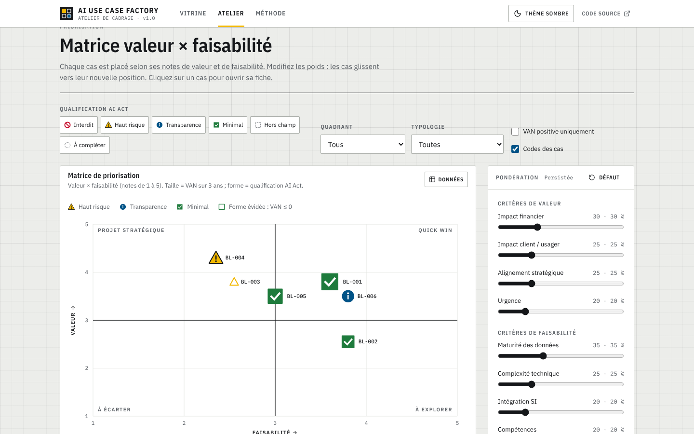
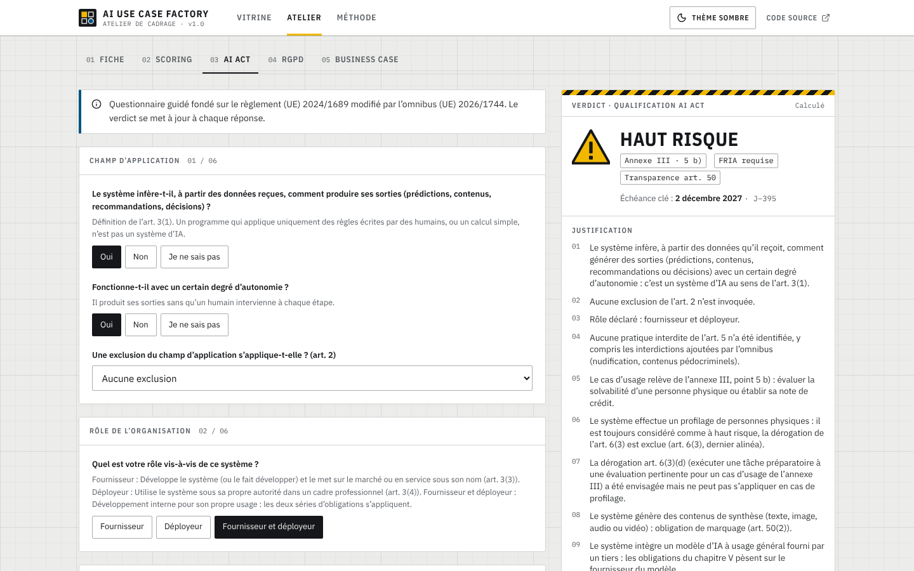
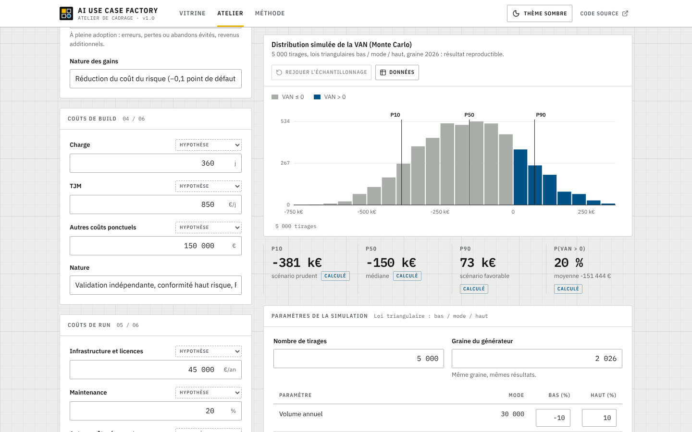
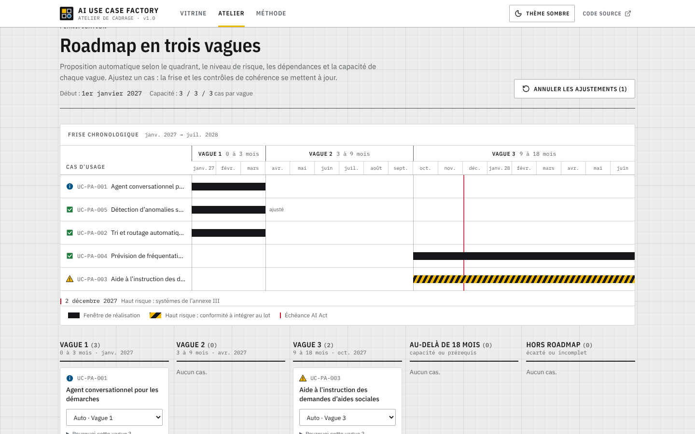
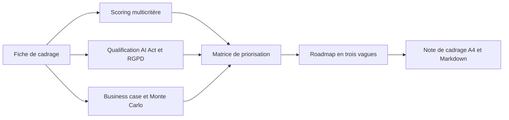

# AI Use Case Factory

> Un atelier web qui aide les Business Analysts et les comités IA à cadrer, prioriser, chiffrer et sécuriser leurs cas d’usage d’intelligence artificielle, pour décider vite et sur des arguments vérifiables.

**[Voir la démo](https://youssefmir.github.io/ai-usecase-factory/)** · [Démarche BA](docs/README.md) · [Résultats clés](#résultats)


*Page d’ouverture : les six cas fictifs de Banque Lumen passent par les cinq postes de l’atelier (cadrage, scoring, AI Act, business case, roadmap), puis se placent dans la matrice.*

## En bref

- **Le problème** : les idées d’IA arrivent plus vite que la capacité à les évaluer ; la valeur est rarement démontrée et la conformité découverte trop tard.
- **La solution** : une même méthode pour chaque cas, de la fiche de cadrage à la roadmap, avec une qualification AI Act et RGPD justifiée et un business case qui mesure son incertitude.
- **Les résultats** : 16 cas fictifs qualifiés dans 3 organisations, dont 4 à haut risque AI Act et 4 dont la VAN à 3 ans est négative ; 195 tests automatisés.
- **Pour qui** : Business Analysts IA, responsables data et innovation, DPO, dirigeants de PME, collectivités.

## Sommaire

[Essayer en 1 minute](#essayer-en-1-minute) · [Ce que vous pouvez faire](#ce-que-vous-pouvez-faire) · [Résultats](#résultats) · [Comment ça marche](#comment-ça-marche) · [La démarche Business Analyst](#la-démarche-business-analyst) · [Référence des commandes](#référence-des-commandes) · [Qualité, données et limites](#qualité-données-et-limites) · [FAQ](#faq)

## Essayer en 1 minute

1. En ligne, sans installation : [youssefmir.github.io/ai-usecase-factory](https://youssefmir.github.io/ai-usecase-factory/).
2. En local, avec Node.js 20.19 ou plus récent :

```bash
git clone https://github.com/youssefmir/ai-usecase-factory.git
cd ai-usecase-factory
npm install
npm run dev
```

Ouvrez ensuite l’adresse affichée par le terminal (par défaut <http://localhost:5173/ai-usecase-factory/>). Trois portefeuilles de démonstration sont chargés au premier lancement ; vos données restent dans le navigateur.

## Ce que vous pouvez faire

### Cadrer un cas d’usage avec une fiche commune

La fiche couvre onze sections : problème métier, personas, situation actuelle (volumes, temps, irritants), solution envisagée, données, intégration au système d’information (SI), indicateurs, parties prenantes, dépendances et risques. Chaque chiffre porte sa provenance : hypothèse, estimation métier ou mesure.


*Fiche du contrôle automatique de complétude des dossiers (Banque Lumen, organisation fictive).*

### Prioriser le portefeuille dans une matrice

Douze critères notés de 1 à 5, chacun avec un descripteur par niveau, donnent une note de valeur, de faisabilité et de risque. La matrice place chaque cas : la taille indique la VAN (valeur actuelle nette), la forme indique la qualification AI Act. Modifiez les poids et les cas glissent vers leur nouvelle position.


*Matrice de Banque Lumen : triangle jaune = haut risque, cercle bleu = transparence, carré vert = risque minimal.*

### Qualifier un cas au regard de l’AI Act et du RGPD

Un questionnaire guidé suit l’ordre du règlement (UE) 2024/1689, modifié par l’omnibus (UE) 2026/1744 : champ d’application, pratiques interdites, haut risque (annexes I et III, dérogation de l’article 6(3)), transparence, modèles à usage général. Le verdict liste sa justification, les obligations par acteur et les échéances. La pré-analyse RGPD applique les neuf critères d’analyse d’impact (AIPD) du CEPD repris par la CNIL.


*Verdict de l’assistant de pré-analyse : profilage, donc dérogation de l’article 6(3) écartée et analyse d’impact sur les droits fondamentaux (FRIA) requise.*

### Chiffrer le business case et son incertitude

Gains de productivité et de qualité, coûts de build et de run (dont le coût des modèles de langage), VAN, ROI, délai de retour et taux de rentabilité interne sur 3 ans. Le diagramme en tornade classe les hypothèses par influence ; la simulation de Monte Carlo construit l’histogramme de la VAN sous vos yeux et donne la probabilité qu’elle soit positive.


*Score d’aide à l’octroi : VAN centrale positive, mais seulement 20 % des 5 000 tirages donnent une VAN positive.*

### Planifier la roadmap et produire la note de cadrage

La roadmap répartit les cas en trois vagues (0 à 3, 3 à 9 et 9 à 18 mois) selon le quadrant, le risque, les dépendances et la capacité ; chaque proposition est expliquée et ajustable. La note de cadrage s’imprime en A4 et s’exporte en Markdown.


*Roadmap de la Ville de Port-Aurèle : l’échéance AI Act du 2 décembre 2027 apparaît sur la frise.*

Autres vues : [thème sombre](docs/img/vitrine-sombre.png), [tableau de bord](docs/img/tableau-de-bord.png), [note de cadrage](docs/img/note-cadrage.png), [mobile](docs/img/mobile.png).

## Résultats

Synthèse calculée par l’application sur les données de démonstration (commande `npm run demo:summary`). Les organisations sont fictives et tous les chiffres d’entrée sont des hypothèses.

| Organisation fictive | Cas (dont quick wins) | Haut risque AI Act | VAN cumulée à 3 ans |
|---|---|---|---|
| Banque Lumen (crédit à la consommation) | 6 (3) | 2 | 1,2 M€ |
| Ardoise Bâtiment (PME du BTP) | 5 (3) | 1 | 138 k€ |
| Ville de Port-Aurèle (collectivité) | 5 (2) | 1 | 35 k€ |

Ce que ces résultats montrent pour un comité :

- **Un score attractif ne suffit pas** : le score d’aide à l’octroi a une VAN centrale de 94 k€, mais 20 % de chances seulement d’être positive, car les coûts sont plus incertains que les gains.
- **La conformité change la décision** : l’optimisation du planning de la PME relève de l’annexe III, point 4 b (attribution des tâches aux salariés) ; avec une VAN négative, l’outil la classe « À écarter ».
- **La valeur n’est pas toujours financière** : l’agent conversationnel de la ville est un quick win pour les usagers malgré une VAN négative ; le scoring rend cet arbitrage explicite.
- **Trois FRIA à prévoir** : le score de crédit, l’assistant de pré-analyse et l’aide à l’instruction des aides sociales.

Une [note de cadrage exportée par l’application](docs/exemples/note-cadrage-UC-BL-004.md) illustre le livrable produit pour un cas.

## Comment ça marche



- **Tout s’exécute dans le navigateur** : aucune API ni base de données ; le site statique est publié sur GitHub Pages.
- **La logique métier est pure et testée** : scoring, qualification, business case et roadmap sont des fonctions sans effet de bord (`src/domain`).
- **Les données sont validées** : des schémas zod décrivent le modèle, valident l’import JSON et les réponses de l’assistant.
- **L’interface est en React et TypeScript strict**, avec un état persisté dans le stockage local et des graphiques SVG animés.
- **Les choix sont documentés** dans le [journal des décisions](docs/decisions.md), y compris la direction artistique.

## La démarche Business Analyst

| Livrable | Ce qu’il apporte | Lien |
|---|---|---|
| Personas | Cinq utilisateurs cibles et leurs scénarios | [personas.md](docs/personas.md) |
| User stories et critères d’acceptation | Backlog en 8 épopées, critères Gherkin, priorités MoSCoW | [user-stories.md](docs/user-stories.md) |
| Méthode de scoring | Grilles, formules, quadrants, règles de la roadmap | [methode-scoring.md](docs/methode-scoring.md) |
| Qualification AI Act et RGPD | Logique, calendrier à jour, sources | [qualification-ai-act.md](docs/qualification-ai-act.md) |
| Business case | Formules et exemple calculé à la main | [modele-business-case.md](docs/modele-business-case.md) |
| Plan de recette | Critères d’acceptation reliés aux tests | [plan-de-recette.md](docs/plan-de-recette.md) |
| Journal des décisions | Choix techniques et de conception | [decisions.md](docs/decisions.md) |

## Référence des commandes

| Commande | Effet |
|---|---|
| `npm run dev` | Serveur de développement |
| `npm run build` | Vérification des types et site statique dans `dist/` |
| `npm run preview` | Prévisualisation du site construit |
| `npm test` | Tests unitaires et d’intégration (Vitest) |
| `npm run test:e2e` | Parcours de bout en bout (Playwright, construit le site au préalable) |
| `npm run lint` | Analyse statique (ESLint) |
| `npm run typecheck` | Vérification des types TypeScript |
| `npm run screenshots` | Régénère les captures de `docs/img` |
| `npm run demo:summary` | Affiche la synthèse calculée des portefeuilles de démonstration |

Le site est publié sous `/ai-usecase-factory/` ; pour un autre chemin, définissez la variable `BASE_PATH` au moment du build (par exemple `BASE_PATH=/ npm run build`).

## Qualité, données et limites

- **Tests** : 184 tests unitaires et d’intégration (dont des valeurs financières calculées à la main et la classification attendue des 16 cas) et 11 parcours de bout en bout, dont l’absence de défilement horizontal sur mobile et l’absence de ressource externe.
- **Données** : trois organisations fictives créées pour le projet ; aucune donnée réelle. Le calendrier AI Act est à jour au 1er novembre 2026, avec ses [sources](docs/qualification-ai-act.md#sources-et-vérification).
- **Avis juridique** : la qualification AI Act et la pré-analyse RGPD sont une aide au cadrage ; elles ne constituent pas un avis juridique.
- **Dates de l’omnibus** : vérifiées à partir de synthèses publiées après le Journal officiel ; les points non confirmés sont signalés « à confirmer ».
- **Business case** : modèle simplifié sur 3 ans, sans fiscalité ni valeur terminale ; les gains non financiers sont portés par le scoring.
- **Assistant de saisie** : fonction optionnelle testée avec des réponses simulées, pas en conditions réelles faute de clé d’API ; certains fournisseurs bloquent les appels directs depuis un navigateur.

## FAQ

### Mes données quittent-elles mon navigateur ?

Non. Les portefeuilles sont enregistrés dans le stockage local du navigateur. Seul l’assistant de saisie, s’il est utilisé, envoie les notes collées au fournisseur que vous choisissez.

### Comment sauvegarder ou partager un portefeuille ?

Utilisez « Exporter » dans l’atelier : le fichier JSON se réimporte sur un autre poste. Un fichier invalide est refusé avec la liste des erreurs.

### Puis-je adapter la méthode à mon organisation ?

Oui. Les poids des critères, les seuils des quadrants, la date de début et la capacité de la roadmap se règlent dans « Paramètres ». Les grilles elles-mêmes se trouvent dans `src/domain/scoring/criteria.ts`.

### Pourquoi certains cas ont-ils une VAN négative ?

Parce que les hypothèses le donnent : coûts de conformité élevés, volumes faibles ou valeur non monétisée (service public). L’outil affiche ce résultat au lieu de le masquer, et le scoring permet de défendre un cas pour d’autres raisons.

### Comment mettre à jour le calendrier AI Act ?

Les dates sont centralisées dans `src/domain/aiAct/calendar.ts` et vérifiées par `qualification.test.ts`. Après une modification, lancez `npm test`.

## Auteur et licence

Youssef Mir, Business Analyst IA · [github.com/youssefmir](https://github.com/youssefmir)

Code sous [licence MIT](LICENSE) · données de démonstration fictives, créées pour ce projet.
