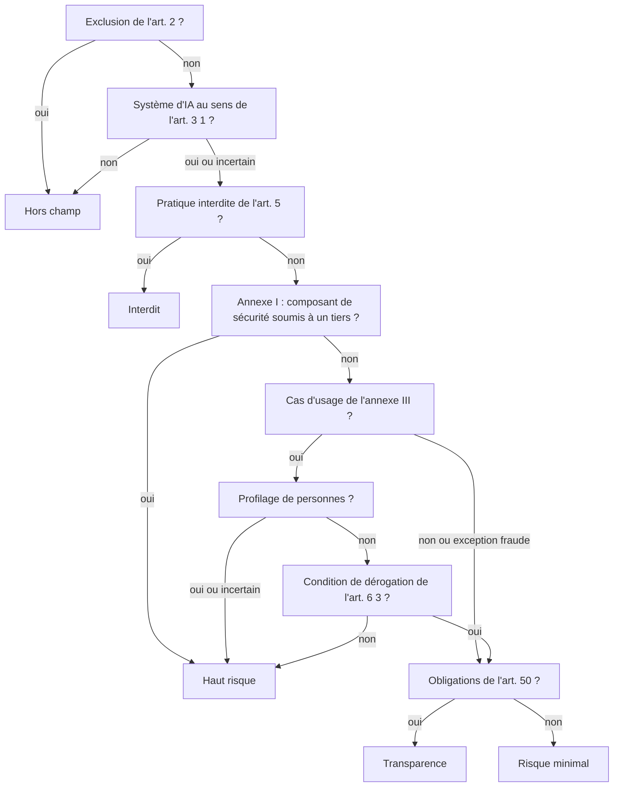

# Qualification AI Act et pré-analyse RGPD

> Aide à la qualification, ne constitue pas un avis juridique. Les règles ci-dessous sont des simplifications destinées au cadrage ; la décision finale revient au juriste et au DPO.

La logique est implémentée dans `src/domain/aiAct/` (qualification, référentiel, calendrier) et `src/domain/rgpd/` (pré-analyse RGPD). Elle est vérifiée par des tests tabulaires : `qualification.test.ts` (cas limites), `evaluation.test.ts` (RGPD) et `demo.test.ts` (classification attendue des seize cas de démonstration).

## Textes de référence

- **AI Act** : règlement (UE) 2024/1689 du 13 juin 2024 établissant des règles harmonisées concernant l’intelligence artificielle.
- **Omnibus numérique sur l’IA** : règlement (UE) 2026/1744, publié au Journal officiel le 24 juillet 2026, en vigueur depuis le 27 juillet 2026. Il modifie le calendrier et plusieurs articles de l’AI Act.
- **RGPD** : règlement (UE) 2016/679, lignes directrices WP248 rév.01 sur l’analyse d’impact (AIPD), approuvées par le CEPD et reprises par la CNIL.

## Ordre d’analyse

Chaque réponse ajoute une ligne à la justification affichée avec le verdict. Les réponses « je ne sais pas » sont traitées par prudence :

| Réponse incertaine | Traitement |
|---|---|
| Définition du système d’IA | L’analyse continue comme s’il s’agissait d’un système d’IA (avertissement) |
| Profilage | Considéré comme présent : la dérogation de l’art. 6(3) n’est pas retenue |
| Annexe I | Avertissement : rattachement à vérifier avec le fournisseur ou la réglementation produit |
| Organisme public | Avertissement sur la FRIA |

Tant qu’une question nécessaire manque, le verdict affiche « Qualification à compléter » avec un **niveau provisoire** et la liste des questions ouvertes.

## Règles modélisées

### Rôle (art. 3 et 25)

- **Fournisseur** : développe ou fait développer le système et le met sur le marché ou en service sous son nom.
- **Déployeur** : utilise le système sous sa propre autorité, dans un cadre professionnel.
- Un déployeur qui modifie substantiellement le système, sa destination, ou le commercialise sous son nom devient fournisseur (art. 25(1)).

Les obligations sont attribuées à un acteur et marquées « vous concerne » selon le rôle déclaré.

### Pratiques interdites (art. 5)

Les huit pratiques de l’art. 5(1) a) à h), et les deux interdictions ajoutées par l’omnibus, applicables au 2 décembre 2026 : systèmes de « nudification » (images intimes non consenties de personnes identifiables) et contenus pédocriminels générés par IA. Une pratique interdite force le verdict et le quadrant « À écarter ».

### Haut risque (art. 6)

- **Annexe I (art. 6(1))** : composant de sécurité d’un produit couvert par la législation d’harmonisation, soumis à une évaluation de conformité par un tiers.
- **Annexe III (art. 6(2))** : les huit domaines et leurs sous-cas sont proposés dans le questionnaire, par exemple :
  - 4 a) recrutement et sélection ; 4 b) décisions sur les conditions de travail, attribution des tâches selon le comportement ou les caractéristiques personnelles ;
  - 5 a) éligibilité aux prestations et services d’aide sociale essentiels (autorités publiques) ;
  - 5 b) évaluation de la solvabilité ou note de crédit, **à l’exception de la détection de fraudes financières** (sous-cas distinct, non haut risque) ;
  - 5 c) tarification et évaluation des risques en assurance vie et santé ; 5 d) appels d’urgence et triage.
- **Dérogation (art. 6(3))** : un système de l’annexe III n’est pas à haut risque s’il remplit une des quatre conditions (tâche procédurale étroite ; amélioration d’une activité humaine préalable ; détection d’écarts sans remplacer l’évaluation humaine ; tâche préparatoire) **et ne réalise pas de profilage**. Le fournisseur documente alors son évaluation (art. 6(4)) et enregistre le système (art. 49(2)).

### Obligations associées

| Situation | Obligations listées |
|---|---|
| Fournisseur d’un système à haut risque | Gestion des risques et des données, documentation, journalisation, notice, contrôle humain, robustesse (art. 9 à 15) ; qualité, évaluation de la conformité, marquage CE, enregistrement (art. 16, 17, 43, 47 à 49) ; surveillance après commercialisation (art. 72, 73) |
| Déployeur d’un système à haut risque | Usage conforme et contrôle humain compétent, données d’entrée, surveillance, journaux conservés six mois, AIPD (art. 26) ; information des représentants du personnel (art. 26(7)) ; information des personnes et droit à l’explication (art. 26(11) et 86) ; enregistrement de l’utilisation par les autorités publiques (art. 49(3)) |
| FRIA (art. 27) | Déployeurs de droit public ou fournissant un service public, et déployeurs des points 5 b) et 5 c), pour l’annexe III hors point 2 |
| Transparence (art. 50) | Information des personnes qui interagissent avec une IA, marquage des contenus de synthèse (fournisseur) ; information sur la reconnaissance des émotions, divulgation des hypertrucages et des textes d’intérêt public (déployeur) |
| Modèles à usage général | Fournisseur du modèle : art. 53 (et 55 en cas de risque systémique) ; intégrateur : exploiter la documentation du fournisseur du modèle (art. 53(1)(b)) |
| Tous | Maîtrise de l’IA du personnel (art. 4) |

## Calendrier appliqué (à jour au 1er novembre 2026)

| Date | Ce qui s’applique |
|---|---|
| 1er août 2024 | Entrée en vigueur du règlement (UE) 2024/1689 |
| 2 février 2025 | Pratiques interdites (art. 5) et maîtrise de l’IA (art. 4) |
| 2 août 2025 | Obligations des fournisseurs de modèles à usage général (chapitre V), gouvernance, sanctions |
| 27 juillet 2026 | Entrée en vigueur de l’omnibus (UE) 2026/1744, publié au JO le 24 juillet 2026 |
| 2 août 2026 | Application générale, dont les obligations de transparence (art. 50) |
| 2 décembre 2026 | Nouvelles interdictions de l’omnibus ; fin du délai de marquage (art. 50(2)) pour les systèmes génératifs mis sur le marché avant le 2 août 2026 (à confirmer) |
| 2 août 2027 | Mise en conformité des modèles à usage général mis sur le marché avant le 2 août 2025 |
| 2 décembre 2027 | Obligations des systèmes à haut risque de l’annexe III (reportées par l’omnibus) |
| 2 août 2028 | Obligations des systèmes à haut risque de l’annexe I (reportées par l’omnibus) |
| 2 août 2030 | Systèmes à haut risque des autorités publiques déjà en service, selon l’art. 111(2) initial (articulation avec l’omnibus à vérifier) |

### Ce que l’omnibus a changé (points utilisés dans l’outil)

- **Report des obligations à haut risque** : annexe III au 2 décembre 2027, annexe I au 2 août 2028 (initialement 2 août 2026 et 2 août 2027).
- **Nouvelles interdictions** : nudification et contenus pédocriminels générés par IA, applicables au 2 décembre 2026.
- **Maîtrise de l’IA (art. 4)** : selon les synthèses consultées, l’obligation reste à la charge des fournisseurs et des déployeurs mais devient une obligation de moyens : prendre des mesures qui favorisent la maîtrise de l’IA, sans niveau garanti ; la Commission et les États membres accompagnent, notamment les PME. L’outil la présente ainsi, avec cette réserve.
- **Marquage des contenus (art. 50(2))** : délai jusqu’au 2 décembre 2026 pour les systèmes déjà sur le marché avant le 2 août 2026, selon plusieurs synthèses (signalé « à confirmer »).
- **Enregistrement des systèmes dérogatoires (art. 6(3))** : maintenu, avec un contenu simplifié, selon les synthèses consultées.

Autres mesures de l’omnibus non modélisées : extension de certains allègements des PME aux petites entreprises de taille intermédiaire, traitement de catégories particulières de données pour la détection des biais, articulation entre FRIA et AIPD. Leur portée exacte est à vérifier dans le texte consolidé.

## Pré-analyse RGPD

| Question | Règle appliquée |
|---|---|
| Données personnelles ? | Non : RGPD non applicable (vigilance sur la réidentification des données agrégées) |
| Données sensibles (art. 9) ? | Oui : interdiction de principe, exception de l’art. 9(2) à identifier |
| Données d’infraction ou de soupçon de fraude (art. 10) ? | Encadrement spécifique |
| Décision exclusivement automatisée à effet juridique ou significatif ? | Oui : art. 22 applicable (exceptions et garanties de l’art. 22(2) et (3), cas de l’art. 22(4) avec données sensibles) |
| Score déterminant pour une décision humaine ? | Vigilance : peut constituer une décision automatisée (CJUE, 7 décembre 2023, SCHUFA, C-634/21) |
| Liste CNIL des traitements soumis à AIPD ? | Oui : AIPD requise |
| Critères WP248 | 2 ou plus : AIPD probablement requise ; 1 : à documenter ; 0 : non requise a priori |

Les neuf critères WP248 : évaluation ou notation ; décision automatisée avec effet juridique ou similaire ; surveillance systématique ; données sensibles ou hautement personnelles ; grande échelle ; croisement de données ; personnes vulnérables ; usage innovant ou nouvelle solution technologique ; exclusion du bénéfice d’un droit, d’un service ou d’un contrat. L’outil **suggère** des critères à partir des autres réponses (profilage, annexe III, données sensibles) et signale ceux qui ne sont pas retenus, sans jamais les imposer.

## Classification attendue des cas de démonstration

Organisations fictives. Ces résultats sont vérifiés automatiquement par `src/data/demo/demo.test.ts`.

| Cas | Verdict | Motif principal |
|---|---|---|
| UC-BL-001 Contrôle de complétude des dossiers | Minimal | Rattaché par prudence au point 5 b, dérogation 6(3)(a) sans profilage ; documentation et enregistrement |
| UC-BL-002 Priorisation des relances | Minimal | Hors annexe III : relance commerciale, sans effet sur l’octroi |
| UC-BL-003 Assistant de pré-analyse (génératif) | Haut risque | Point 5 b avec profilage : la dérogation 6(3)(d) envisagée est écartée ; transparence art. 50(2) ; FRIA |
| UC-BL-004 Score d’aide à l’octroi | Haut risque | Évaluation de la solvabilité (point 5 b) ; FRIA |
| UC-BL-005 Détection de fraude documentaire | Minimal | Exception explicite du point 5 b (détection de fraude) |
| UC-BL-006 Assistant conversationnel client | Transparence | Interaction directe (art. 50(1)) et contenus générés |
| UC-AB-001 Veille des appels d’offres | Minimal | Aucun domaine de l’annexe III |
| UC-AB-002 Analyse des DCE | Minimal | Extraction structurée avec citation des sources |
| UC-AB-003 Rédaction du mémoire technique | Transparence | Contenus générés (art. 50(2)), obligation portée par l’éditeur |
| UC-AB-004 Estimation de prix (DECP) | Minimal | Prévision sur données publiques |
| UC-AB-005 Optimisation du planning chantiers | Haut risque | Attribution nominative des tâches selon des caractéristiques personnelles (point 4 b) ; information du CSE |
| UC-PA-001 Agent conversationnel des démarches | Transparence | Interaction directe (art. 50(1)) |
| UC-PA-002 Tri du courrier | Minimal | Routage, hors annexe III |
| UC-PA-003 Aide à l’instruction des aides sociales | Haut risque | Point 5 a, autorité publique ; FRIA |
| UC-PA-004 Prévision de fréquentation | Minimal | Données agrégées |
| UC-PA-005 Anomalies des factures d’énergie | Minimal | Contrôle de factures, pas un composant de sécurité |

## Cas limites testés

Le fichier `src/domain/aiAct/qualification.test.ts` couvre notamment :

- fraude contre solvabilité (point 5 b et son exception, avec l’avertissement associé) ;
- dérogation 6(3) avec et sans profilage, profilage incertain traité par prudence ;
- assistant conversationnel (transparence) et assistant génératif à haut risque (cumul des obligations) ;
- FRIA : autorité publique, point 5 b, et point 2 (infrastructure critique, exclu) ;
- emploi (point 4 b) et information des représentants du personnel ;
- interdictions de l’art. 5, dont celles ajoutées par l’omnibus et leur date d’application ;
- rôle de déployeur devenant fournisseur (art. 25) ;
- calendrier : statut « en vigueur » ou « à venir » et nombre de jours restants.

## Sources et vérification

Vérification des dates et des changements de l’omnibus réalisée le 1er novembre 2026 par recherche web. Les sites indiqués dans le cahier des charges et EUR-Lex n’ont pas pu être ouverts directement depuis l’environnement de développement (accès réseau restreint) ; les informations ont été recoupées à partir des résumés de recherche suivants :

- National Law Review, « EU Digital Omnibus on AI Enters into Force » : <https://natlawreview.com/article/eu-digital-omnibus-ai-enters-force>
- Cloud Security Alliance, note de recherche sur le report des obligations à haut risque : <https://labs.cloudsecurityalliance.org/research/csa-research-note-eu-ai-act-high-risk-deadline-omnibus-20260/>
- iubenda, adoption de l’omnibus par le Parlement (juin 2026) : <https://www.iubenda.com/en/blog/ai-omnibus-parliament-adoption-june-2026>
- euaiact.com, synthèse de l’omnibus : <https://www.euaiact.com/digital-omnibus-ai>
- Cuatrecasas, « Digital Omnibus on AI has been published » : <https://www.cuatrecasas.com/en/spain/intellectual-property/art/digital-omnibus-ai-has-been-published>
- Garrigues, publication du règlement omnibus : <https://www.garrigues.com/en_GB/garrigues-digital/ai-digital-omnibus-regulation-has-been-published-redefining-deadlines-and>
- KI-Campus, art. 4 après l’omnibus : <https://ki-campus.org/en/blog/eu-ai-act-ai-omnibus-recalibrates-article-4-ai-literacy-remains-mandatory>
- Digital Policy Alert, délai de marquage de l’art. 50(2) : <https://digitalpolicyalert.org/event/42377-ai-act-synthetic-content-marking-obligation-transitional-period-for-systems-placed-on-the-market-before-2-august-2026-becomes-applicable>
- Digital Policy Alert, nouvelles interdictions applicables : <https://digitalpolicyalert.org/event/42386-digital-omnibus-on-ai-regulation-prohibiting-nudification-apps-and-ai-systems-generating-or-manipulating-child-sexual-abuse-material-becomes-applicable>
- Cooley, « Digital AI Omnibus delays key deadlines, introduces new rules » : <https://cdp.cooley.com/digital-ai-omnibus-delays-key-deadlines-introduces-new-rules/>
- CNIL, liste des traitements pour lesquels une AIPD est requise : <https://www.cnil.fr/fr/liste-traitements-aipd-requise>

Textes officiels à consulter pour toute décision :

- Règlement (UE) 2024/1689 : <https://eur-lex.europa.eu/eli/reg/2024/1689/oj>
- Règlement (UE) 2026/1744 : <https://eur-lex.europa.eu/eli/reg/2026/1744/oj>
- RGPD : <https://eur-lex.europa.eu/eli/reg/2016/679/oj>
- Lignes directrices WP248 rév.01 : <https://ec.europa.eu/newsroom/article29/items/611236>
- CJUE, C-634/21 (SCHUFA) : <https://curia.europa.eu/juris/liste.jsf?num=C-634/21>

En cas de divergence entre ces synthèses et le texte publié au Journal officiel, le texte officiel prévaut ; les points incertains sont signalés « à confirmer » dans l’interface.
